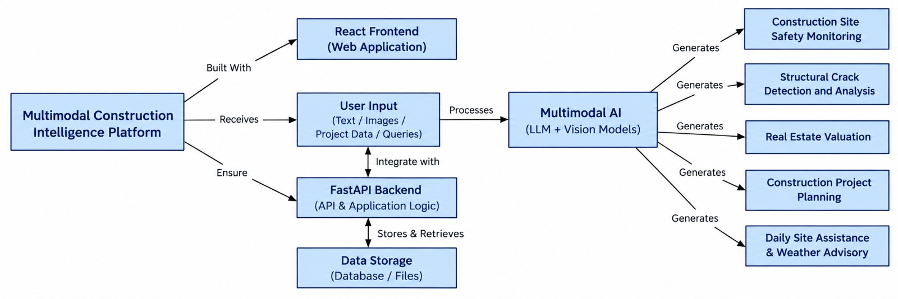

# Multimodal Construction Intelligence Platform

A full-stack decision-support system for construction professionals. It analyses site photos, text and structured project data with a multimodal large language model and returns structured, schema-validated reports.

| Link | URL |
|---|---|
| Live demo | DEMO_LINK_HERE |
| GitHub repository | GITHUB_LINK_HERE |

Replace the two placeholders above before submission so the mentor can review the project.

## Architecture



The user submits text, images and project data through the React frontend. The FastAPI backend validates the input, stores and retrieves records, and sends the request to the multimodal model. The model output is validated against a strict JSON schema and then rendered by the frontend. The same diagram is shown inside the app on the Architecture page.

### Request flow

1. React sends a multipart form (images and text) or a JSON body to `/api/...`.
2. FastAPI validates fields. Images are fully decoded, so corrupt or truncated files are rejected, then resized and re-encoded.
3. The LLM gateway sends a task-specific system prompt that embeds the JSON schema.
4. The reply is parsed and validated. On failure it retries once with the validation error. After a second failure the API returns `invalid_ai_response`.
5. Numeric and geometric output (costs, schedule, floor layout) is verified and corrected by deterministic code.
6. The result is saved to SQLite and returned in a uniform envelope.

## Features

| Module | What it produces |
|---|---|
| Site safety monitoring | Hazards with severity, location and corrective action; PPE status table; recommendations |
| Crack detection and analysis | Crack type, orientation, estimated width, severity, probable causes, repairs, monitoring plan, engineer-review flag |
| Project planning | Floor layout drawing, material estimate, cost breakdown, Gantt schedule, elevation notes, risks |
| Real estate valuation | Low, likely and high value, price per sq ft, factors, assumptions |
| Daily site assistant | Direct answer, prioritised checklist, warnings, follow-up questions |
| Weather advisory | Live five-day forecast with go, caution or hold per activity |
| Construction knowledge | Technical answer, key points, standards to verify |
| History | Every analysis stored, reopened or deleted |

## Technology

- Frontend: React 18, Vite, plain CSS, Vitest
- Backend: Python 3.9+, FastAPI, Pydantic v2, Pillow, SQLite, httpx
- AI: Anthropic API or AWS Bedrock (multimodal), with an offline mock provider for development and testing
- Weather: Open-Meteo (no key required)

## Setup

Requirements: Python 3.9 or later, Node.js 18 or later, Git.

```bash
git clone GITHUB_LINK_HERE construction-intelligence
cd construction-intelligence

# Backend
cd backend
python -m venv .venv
source .venv/bin/activate          # Windows: .venv\Scripts\activate
pip install -r requirements.txt
cp .env.example .env               # then edit .env
python -m uvicorn app.main:app --reload --port 8000

# Frontend (new terminal)
cd frontend
npm install
npm run dev                        # http://localhost:5173
```

Or run both with `./run.sh`.

### Choosing the AI provider

Edit `backend/.env`. Keys are read from the environment and never sent to the browser.

| LLM_PROVIDER | Needs | Notes |
|---|---|---|
| mock | nothing | Default. Deterministic demo output, no image understanding |
| anthropic | ANTHROPIC_API_KEY, optional ANTHROPIC_MODEL | Vision-capable Claude model |
| bedrock | AWS credentials via `aws configure`, AWS_REGION, BEDROCK_MODEL_ID | Use a vision-capable model enabled in your account |

The UI shows a "Demo output" badge whenever the mock provider produced a result.

### Single-process build

```bash
cd frontend && npm run build
cd ../backend && python -m uvicorn app.main:app --port 8000   # serves the app at http://localhost:8000
```

Or `docker build -t construction-ai . && docker run -p 8000:8000 --env-file backend/.env construction-ai`.

## Project structure

```
backend/app/
  main.py        app setup, error handlers, static hosting
  routes.py      all endpoints
  schemas.py     strict JSON contracts
  llm.py         provider adapters, JSON extraction, repair retry
  prompts.py     task prompts
  planlib.py     cost, schedule and layout verification
  images.py      upload validation and normalisation
  storage.py     SQLite history
  weather.py     Open-Meteo client
  mock.py        offline provider
backend/tests/   pytest suite
frontend/src/
  pages/         one file per module
  components/    shared UI and SVG charts
  api.js         API client with error mapping
docs/            architecture diagram, API, testing, limitations
sample_data/     example inputs for a demo
```

## Documentation

- [API reference](docs/API.md)
- [Testing](docs/TESTING.md)
- [Known limitations](docs/LIMITATIONS.md)
- [Sample inputs](sample_data/sample_inputs.md)

## Demo script

1. Open Dashboard, then Architecture.
2. Site safety: upload a site photo, add a note, run the analysis.
3. Crack analysis: upload a wall crack photo with a coin for scale.
4. Project planning: 30 x 50 ft plot, 2 floors, 3 bedrooms, Standard. Show the layout, Gantt chart and cost table.
5. Valuation, Daily assistant, Weather advisory (for example Bhopal), Knowledge.
6. History: reopen an earlier report.
7. Show an error case: upload a corrupt image.

## Safety notice

Outputs are decision support. They do not replace a qualified site safety officer, a licensed structural engineer or a certified valuer.
